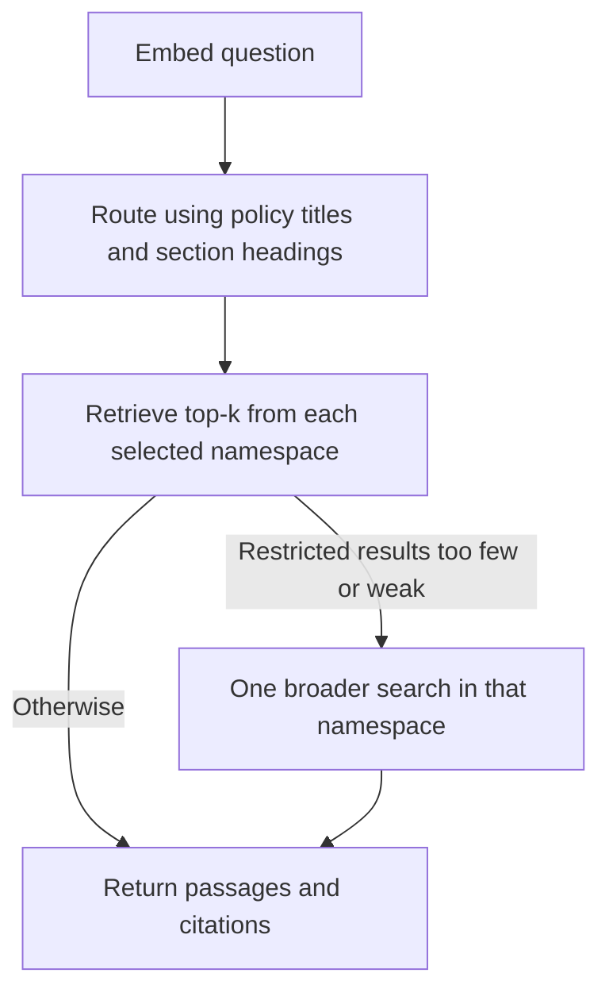

# Gridaxon HR Q&A

## Step 1: Markdown ingestion

Run from this project directory in PowerShell:

```powershell
uv run gridaxon-hr-qa ingest --data-dir "C:\Users\aksha\OneDrive\Desktop\Mastering Agentic AI\Projects\2. GridAxon HR Policy - RAG\gridaxon-hr-rag-starter"
```

The loader reads only `corpus/*.md`, parses YAML front matter, validates required
metadata and unique current document IDs, and writes `storage/documents.jsonl`.
Each JSON line contains metadata, the policy body (`text`), original decoded
Markdown (`raw_markdown`), a relative source path, and the original file's SHA-256.
YAML dates become ISO date strings. All additional metadata fields are retained.
The source files are never edited. Archive, evaluation, and reference files are
excluded. Re-running ingestion replaces the generated output after validation.

Inspect the output:

```powershell
Get-Content .\storage\documents.jsonl -First 1 | ConvertFrom-Json | Format-List
```

Run the ingestion checks:

```powershell
uv run python -m unittest discover -s tests -v
```

This step does not chunk, embed, or upload documents. The next step will produce
fixed and semantic chunks from the policy bodies while retaining source metadata.
This corpus is fictional educational material, not an adopted company policy.

## Step 2: Fixed chunking

After ingestion, run:

```powershell
uv run gridaxon-hr-qa chunk-fixed --chunk-size 300 --overlap 50
```

This reads `storage/documents.jsonl` and writes `storage/chunks_fixed.jsonl`.
Change paths with `--input` and `--output`. Input and output must differ.
The first run may download the tiktoken vocabulary; no policy text is uploaded.

The chunker first separates Markdown H2 sections, ignoring headings inside code
fences. Numbered headings retain their reference, such as `1` for `## 1. PTO`.
Introductory text is retained under `intro`; unnumbered headings receive positional
references. Each section is split into windows of at most 300 `cl100k_base` tokens,
with 50 tokens of requested overlap. Short sections remain a single chunk. No
overlap crosses section boundaries. Unicode character boundaries can slightly
reduce the window or overlap. This fixed token-window approach can still split
sentences, so inspect exceptions and qualifications before evaluating retrieval.

Each chunk includes:

- A deterministic `chunk_id`, sensitive to source hash, metadata, configuration,
  and offsets; rerunning with identical inputs produces identical IDs.
- All document `metadata`, including ID, title, version, dates, and status.
- `section`, `section_title`, and section-local chunk number.
- `source_path`, `source_sha256`, and exact `text`.
- `start_char` and exclusive `end_char`, indexing the ingested document's `text`
  (not the original Markdown containing YAML front matter).
- Section start/end offsets, `token_count`, and chunking configuration.

Inspect the first numbered section's chunk:

```powershell
$chunks = Get-Content .\storage\chunks_fixed.jsonl | ForEach-Object { $_ | ConvertFrom-Json }
$sample = $chunks | Where-Object { $_.section -eq '1' } | Select-Object -First 1
$sample | Select-Object chunk_id, section, section_title, token_count, start_char, end_char
$sample.metadata
$sample.text
```

The token limit covers chunk text only, including any heading present in that
slice. Before embedding, account for any added title/section prefixes and the
chosen embedding model's own tokenizer and input limit. The tokenizer here is
a reproducible baseline, not a commitment to a particular embedding provider.
See [tiktoken documentation](https://github.com/openai/tiktoken).

Run all tests with `uv run python -m unittest discover -s tests -v`.
The next step is semantic chunking, using the same source metadata and sections.

## Step 3: Semantic chunking

```powershell
uv run gridaxon-hr-qa chunk-semantic
```

This reads the same `storage/documents.jsonl` and writes a separate
`storage/chunks_semantic.jsonl`. Fixed chunks remain in `chunks_fixed.jsonl`.
The first run downloads the public `sentence-transformers/all-MiniLM-L6-v2`
model's ONNX export (`Qdrant/all-MiniLM-L6-v2-onnx`) from Hugging Face. FastEmbed
computes sentence embeddings locally on CPU; policy
text is not sent to an embedding API. These temporary sentence vectors determine
boundaries only. Final chunk embeddings and Pinecone uploads come in a later step.

How it works:

1. Reuse the exact same section boundaries as fixed chunking.
2. Split each section into English sentences with pySBD, retaining exact offsets
   and whitespace. Attach the section heading to the first sentence.
3. Split any oversized sentence into smaller pieces before embedding, respecting
   both the sentence model's input limit and the chunk token ceiling.
4. Embed the sentence pieces and calculate cosine distance between adjacent pieces.
5. End a chunk at a distance of at least `0.45` once it contains at least 80 tokens
   and at least 80 tokens remain in the section, or before adding the next piece
   would exceed 300 tokens. This avoids semantic breaks that leave tiny tails.
6. Retain short section endings. No chunk or overlap crosses a section boundary.

The 80-token minimum is soft: short sections, tails, and forced size cuts can be
smaller. The 300-token maximum is hard and uses the same `cl100k_base` tokenizer
as fixed chunking. Semantic chunks have **zero overlap**; this comparison therefore
varies overlap as well as boundary selection. For a more controlled experiment,
also generate a fixed baseline with `--overlap 0` into a separate output file.
These are initial settings to tune using retrieval evaluation, not proven optimal
values. Adjacent-sentence similarity does not guarantee that an exception stays
with its rule. Inspect chunks and test policy questions before choosing a winner.

Customize settings:

```powershell
uv run gridaxon-hr-qa chunk-semantic --min-tokens 80 --max-tokens 300 --distance-threshold 0.45
```

A higher distance threshold makes semantic breaks less frequent. Outputs include
the same source/section/offset fields as fixed chunks, plus `boundary_reason`
(`semantic_break`, `max_tokens`, or `section_end`) and `distance_to_next_unit`.
The resolved model commit is saved in `chunking.embedding.revision`; pass it back
with `--model-revision <commit>` for a later run using identical model weights.
`uv.lock` pins the Python dependencies. Chunk IDs incorporate the model/configuration
and boundaries. Small numerical differences across runtime/hardware can still
change boundaries near the threshold.

Inspect and compare:

```powershell
$fixed = @(Get-Content .\storage\chunks_fixed.jsonl | ForEach-Object { $_ | ConvertFrom-Json })
$semantic = @(Get-Content .\storage\chunks_semantic.jsonl | ForEach-Object { $_ | ConvertFrom-Json })
$fixed.Count
$semantic.Count
$semantic | Group-Object boundary_reason | Select-Object Name, Count
$semantic | Where-Object { $_.metadata.document_id -eq 'HR-008' -and $_.section -eq '1' } | Format-List section_title, token_count, boundary_reason, text
```

Chunk counts alone do not measure quality. Compare evidence-section recall,
answer support, and context token budgets when retrieval is implemented.
The unit tests use deterministic test vectors to isolate grouping behavior;
running the CLI exercises the actual downloaded model.

References: [FastEmbed supported models](https://qdrant.github.io/fastembed/examples/Supported_Models/)
and [MiniLM model card](https://huggingface.co/sentence-transformers/all-MiniLM-L6-v2).

## Step 4: Complete-chunk embeddings and Pinecone

The retrieval embedding model is `BAAI/bge-small-en-v1.5` via the local FastEmbed
ONNX backend. Both fixed and semantic chunks use the same model and revision:
384-dimensional normalized vectors, cosine similarity, and a 512-model-token
input limit. These vectors embed the **complete chunk**, prefixed with its policy
title and section title. Every input is checked against the model tokenizer's
limit before embedding; oversized inputs fail rather than being truncated.
MiniLM remains the sentence-similarity model for semantic boundary selection only.

Keep configuration in `.env` (already ignored by Git). See `.env.example`:

```dotenv
PINECONE_API_KEY=your-key-here
PINECONE_INDEX=gridaxon-hr-qa
PINECONE_CLOUD=aws
PINECONE_REGION=us-east-1
```

Environment variables override `.env`. The built-in config reader supports simple
`KEY=value` lines, single/double quoted values, and comments; it does not expand
variables or execute shell syntax. Never paste the key into source code or commit it.

Run from this project directory:

```powershell
uv run gridaxon-hr-qa embed-chunks
uv run gridaxon-hr-qa index-chunks --create-index
```

`embed-chunks` downloads public weights on first use and processes policy text
locally. It writes vector JSONL artifacts and `storage/embedding_manifest.json`.
Use `--model-revision <commit>` to reuse the recorded BGE model weights.

`index-chunks` loads the key and uploads vectors **and policy text/citation metadata**
to Pinecone. It uses the REST vector API through Python's standard library; no
Pinecone SDK is required. `--create-index` creates a serverless index only when
absent, with deletion protection enabled. Existing indexes must have matching
dimensions and cosine metric. Without that flag, a missing index is an error.

Each build has two namespaces: `fixed-<build-id>` and `semantic-<build-id>`.
The build ID includes source chunks, embedding model revision, and preprocessing.
Identical reruns upsert the same IDs. Changed builds get new namespaces, keeping
old records out of the active comparison without deleting any remote data.
Old namespaces remain stored until you deliberately clean them up.

Uploads run in batches. The command fetches every record back and checks both its
vector values and metadata, allowing a bounded wait for eventual consistency.
Only after **both** namespaces pass verification does it write
`storage/pinecone_active.json`, which the retrieval step should use. If a run fails,
rerun it safely; partially uploaded namespaces are not marked active.

Inspect the active configuration (contains no API key):

```powershell
$active = Get-Content .\storage\pinecone_active.json -Raw | ConvertFrom-Json
$active.index
$active.embedding
$active.datasets | Format-List
```

For retrieval, load the model revision from this file and use `ChunkEncoder.encode_query()`
so query vectors use the same model, normalization, and BGE query prefix. Select
exactly one active namespace for each experimental arm. Always retrieve source text
and metadata with the matches for citations. A 384-dimensional vector from a
different model is not interchangeable with this model's vectors.

Validation: `uv run python -m unittest discover -s tests -v` covers source-version
consistency, vector validation, artifact integrity, index compatibility, namespace
isolation, idempotent uploads, and verification failures. Tests use a fake Pinecone
client; the CLI's fetch-back checks verify the live uploaded records.

API references: [create index](https://docs.pinecone.io/reference/api/2025-10/control-plane/create_index),
[upsert](https://docs.pinecone.io/reference/api/2025-10/data-plane/upsert),
and [fetch](https://docs.pinecone.io/reference/api/2025-10/data-plane/fetch).

## Step 5: Top-k retrieval and LangGraph routing

Direct top-k search in both namespaces:

```powershell
uv run gridaxon-hr-qa retrieve "How much PTO do full-time employees accrue?" --method both --top-k 5 --show-text
```

Run the same search through LangGraph:

```powershell
uv run gridaxon-hr-qa route-query "How much PTO do full-time employees accrue?" --method both --top-k 5 --show-text --output storage/routed_pto.json
```

Use `--method fixed` or `--method semantic` to inspect one experimental arm.
Each result contains a similarity score, source text, citation label, metadata,
and character offsets. Scores are **not confidence probabilities**. `--output`
saves the result as JSON; omit it for console-only output. This stage returns
retrieval candidates, not generated or relevance-graded answers.

The retriever loads `pinecone_active.json`, verifies the local active artifact
checksums, and loads the pinned BGE model revision with the same query prefix and
normalization used for indexing. It requests metadata from Pinecone and rejects
incompatible build/model/method metadata. It deduplicates IDs but keeps separate
chunks from the same section. Queries never write to the index.

### Graph behavior



The router is a **local embedding-based baseline**, implemented as actual
LangGraph nodes and conditional edges. No LLM/API key is required for routing.
It embeds policy titles and section headings, caches those catalog vectors for
the process, and selects up to three policies. It uses the same routing decision
for fixed and semantic searches to keep the comparison consistent.

If the best catalog score is below 0.35, or the top and fourth catalog scores
are within 0.06, it searches all eligible policies. If a restricted search returns
fewer than k results or its best score is below 0.35, it retries that namespace
once without the routing restriction. These are initial heuristic settings, not
calibrated measures of relevance or answer sufficiency. A high-scoring wrong
passage can still pass these checks; the next stage adds relevance/coverage grading.
The graph has no retry loop and is invoked with a bounded recursion limit.

Explicit policy IDs in the question restrict the routed scope:

```powershell
uv run gridaxon-hr-qa route-query "Compare HR-005 and HR-006 on handbook acknowledgment" --top-k 5
uv run gridaxon-hr-qa retrieve "PTO accrual" --document-id HR-008 --method fixed
```

Unknown policy IDs fail clearly. Explicit policy scope is never broadened.
Use `--document-id` repeatedly with direct retrieval for multiple policies.

`--as-of YYYY-MM-DD` excludes currently indexed policies that were not effective
yet. For example, `--as-of 2026-03-01` excludes HR-008 v2.0. It does **not** retrieve
HR-008 v1.0: the archive has not been indexed. Dates must be supplied explicitly;
natural-language date extraction and conversational follow-up resolution are not
implemented at this stage. The default is the machine's current date. Only current
policy records are eligible. Do not interpret empty or weak results as proof that
a policy does not exist, and do not use this baseline to answer historical questions.

### Validation and observed results

```powershell
uv run python -m unittest discover -s tests -v
uv run gridaxon-hr-qa check-retrieval --top-k 5
```

The live check sends four development questions (PTO, harassment reporting,
remote-work expenses, and handbook/non-compete) through direct and routed search
in both namespaces. This produces 16 checks and saves passages, routing traces,
timings, and evidence labels to `storage/retrieval_checks.json`.
It does not ingest or tune on the supplied 40-question evaluation file.

The initial top-5 and top-10 runs both retrieved the expected exact reference
sections in 12/16 checks. The four handbook checks retrieved HR-006 section 4
instead of the seed reference's section 2. Source inspection verified section 4
explicitly supports the same claim: handbook acknowledgment does not execute a
restrictive covenant. With this documented alternative, all 16 checks have their
required evidence. Reports preserve both strict reference misses and accepted
alternatives; absence of the second required policy still fails the check.
This small development set does not establish overall RAG accuracy or demonstrate
that routing is better than broad search. Short semantic chunks may contain only
part of a labeled section; a section hit alone is not proof of complete support.

The next step is an evidence relevance/coverage grader, followed by answer
generation and claim/citation validation. Keep the raw `retrieve` command as the
baseline when evaluating whether those additions improve quality.

References: [Pinecone vector query API](https://docs.pinecone.io/reference/api/2025-10/data-plane/query)
and [LangGraph Graph API](https://docs.langchain.com/oss/python/langgraph/graph-api).

## Step 6: Relevance and evidence-coverage grading

Add your OpenAI API key to this project's saved `.env` file:

```dotenv
OPENAI_API_KEY=your-key-here
OPENAI_GRADER_MODEL=gpt-5-mini
```

Run retrieval and grading for both chunking methods:

```powershell
uv run gridaxon-hr-qa grade-query "How much PTO do regular full-time employees accrue per year?" --as-of 2026-10-25 --output storage/graded_pto.json
```

Use `--method fixed` or `--method semantic` for one arm, `--top-k` to set the first
candidate count (1–20), and `--model` to override the configured grader model.
The default output is `storage/graded_query.json`. This command calls the OpenAI
Responses API using your API billing and sends the question and retrieved policy
passages to OpenAI. Requests use `store: false`; this is not a claim of zero data
retention. It does not upload the whole corpus or the evaluation answers.
There is no answer generator in this step.

The LangGraph flow is:

```text
Plan question requirements without seeing passages
  → Existing routing and retrieval
  → Grade each namespace independently
  → If evidence is missing: one wider retrieval and a fresh grade
  → Compute the generation gate
```

The same question plan is shared across the two experimental arms. This prevents
each arm from defining its requirements around whichever evidence happened to be
retrieved. The grader labels every chunk relevant/irrelevant and assesses every
requirement as `supported`, `partial`, or `missing`. It records concise reasons,
supporting source-span IDs, unresolved conflicts, and essential clarification questions.
Similarity scores are not included in the grading payload.

The model selects numbered nonblank source lines (`chunk_id` plus `span_id`) instead
of copying quotations. The application resolves those IDs to the original text and
adds `quote`, `quote_start_char`, and exclusive `quote_end_char` to each evidence
item. These offsets are relative to the retrieved chunk text; add the chunk's
`start_char` to locate the passage within the ingested policy body. This avoids
copying failures caused by paraphrases or changes to whitespace/punctuation without
weakening the exact-source check. Unknown chunks/spans still block generation.

Application checks require all input chunks and requirements to be represented
exactly once, every evidence ID to exist, cited chunks to be marked relevant, and
every quote to appear verbatim in its source. The application computes
`evidence_sufficient` and `can_generate`; a model-supplied ready flag cannot override
these checks. A matching quote establishes provenance, not entailment: the model's
judgment about whether the quote actually supports the requirement still needs
evaluation. A question plan can also omit an important requirement. Neither schema
validation nor an LLM judge guarantees a correct or complete answer.

Final decisions:

| Decision | Meaning | Generate? |
|---|---|---|
| `ready` | Every requirement is supported; no conflict or clarification | Yes, in the later generation step |
| `clarify` | Essential user information is missing | No |
| `resolve_conflict` | Applicable evidence conflicts | No |
| `abstain` | Evidence remains incomplete after the retry | No |
| Error | API, schema, quote, or identity validation failed | No |

The coverage retry doubles k (at least 10, at most 50), broadens routing when
allowed, and preserves the as-of date and any explicitly named policy scope. Only
insufficient arms are retried. If retrieved IDs are unchanged, the prior grade is
retained; changed evidence is graded again. This is one coverage retry in addition
to the existing router's optional broad-search fallback. No unbounded loop exists.
An exhausted retry becomes `abstain`; the supported parts and gaps remain visible
for review. Partial answer generation is intentionally not enabled yet.

The report contains `plan`, `first_grades`, final `grades`, retained passages,
`generation_ready` per method, traces, and successful OpenAI call metadata/token
usage. Keys never appear in reports. On a failed CLI run, the requested output file
is replaced with an error report containing `can_generate: false`, so it cannot
look like a successful result from an earlier question. The grading model defaults
to `gpt-5-mini`; the actual returned model name is logged for successful calls.

For a question that policies cannot answer, try:

```powershell
uv run gridaxon-hr-qa grade-query "What is my personal PTO balance today?" --output storage/graded_personal_balance.json
```

The expected outcome is clarification or abstention, not a fabricated balance.
This is a suggested check, not a claim that a live model run has passed it.

Tests use controlled model responses to verify partial/missing coverage, conflicts,
clarification, fabricated citations, omitted requirements, independent namespace
gates, bounded retry, and OpenAI refusal/incomplete/error handling:

```powershell
uv run python -m unittest discover -s tests -v
```

Live validation on the PTO accrual question now passes in both namespaces, with
exact quotes resolved from source-span IDs and `can_generate: true`. The fixed arm
retained 4/5 passages and the semantic arm 3/5 in this run. The question planner is
given the fictional GridAxon/Texas application context and instructed to avoid
unrequested requirements such as tenure tiers or separation payouts. This is a
development check, not a broad accuracy benchmark; LLM judgments can vary.

If OpenAI returns HTTP 429, check the project's API billing/credits, quota, and
rate-limit settings, then rerun `grade-query`. The error
message identifies `insufficient_quota` or `rate_limit_exceeded` when OpenAI provides
one of those codes; otherwise it reports the general 429 without exposing the raw
response. No automatic HTTP retry is performed, avoiding hidden repeat requests.

References: [OpenAI Structured Outputs](https://developers.openai.com/api/docs/guides/structured-outputs)
and [GPT-5 mini model](https://developers.openai.com/api/docs/models/gpt-5-mini).

## Step 7: Generate and validate cited answers

From the project directory, run:

```powershell
uv run gridaxon-hr-qa answer-query "How much PTO do full-time employees accrue?" --as-of 2026-10-25 --output storage/answered_pto.json
```

This runs retrieval and evidence grading again, then generates and checks an answer
independently for each namespace. Use `--method fixed` or `--method semantic` for
one arm. The command also accepts `--top-k`, `--model`, and `--env-file`. It uses
the configured OpenAI grader model for generation and checking, and incurs API
charges. The default report is `storage/answered_query.json`.

```text
Existing evidence grading and generation gate
  -> Generate claims using approved source spans
  -> Validate citation IDs and check claim support and answer coverage
  -> If unsuccessful: revise once using the same evidence, then recheck
  -> Display a validated answer, or abstain
```

Only spans selected as evidence for supported requirements reach the generator.
Every factual claim must cite an approved chunk/span pair from its own namespace.
The application validates these IDs and renders document/section citation labels
from stored metadata. The groundedness judge sees each claim's cited spans and
assesses its assertions, numbers, conditions, and exceptions. It also checks that
the actual answer covers every planned requirement. Missing assessments, unsupported
claims, or incomplete coverage block publication; a model-supplied success flag
cannot bypass application checks.

There are at most two generation attempts per eligible namespace. A revision uses
the same approved evidence and receives validation feedback. This is separate from
the upstream evidence grader's bounded retrieval retry. A closed evidence gate
produces clarification, a conflict notice, or abstention without generating an answer.

The report's `answers` field contains the displayable responses and cited source
spans, including original text, document metadata, and chunk-relative offsets.
`checks` records claim support and requirement coverage. `attempts` and `drafts`
are internal audit data and can include rejected text: a future UI should display
`answers`, never those unverified drafts. Fixed and semantic results are kept
separate for comparison; one arm passing does not approve the other arm.

Citation identity checks are deterministic. Semantic support and coverage checks
use a separate call to the same model, so correlated mistakes remain possible.
Passing these checks is an automated assessment, not proof of correctness; broader
evaluation against the held-out question set remains necessary.

Validation: all 70 unit tests pass. A live PTO accrual query passed the citation,
groundedness, and coverage checks on its first attempt in both namespaces, citing
HR-008 v2.0 section 1. Saved source text was also checked against its exact chunk
offsets. See `storage/answered_pto.json` for this development run; it is not a broad
accuracy benchmark.

## Step 8: GridAxon employee portal

Run from `gridaxon-hr-qa`:

```powershell
uv sync
uv run streamlit run streamlit_app.py
```

Open `http://localhost:8501`. The app uses a Workday-inspired People Hub layout:
a searchable library of all ingested policies, a prominent question form, suggested
questions, validated answers, and numbered source references. The existing corpus
is synthetic, so the interface identifies it as a demo policy corpus.

1. Type a question and choose **Ask question**. Suggested topics fill the form;
   they do not submit automatically.
2. Read the answer and select a numbered citation to jump to its source card.
3. Choose **Open full document**, or select a policy in the library, to read it.
   Referenced documents are highlighted and sorted first. The document viewer
   highlights exact cited passages when document checksums and body offsets match.
4. Download the original Markdown from the document viewer if needed.

The employee view currently uses the fixed namespace with top-k 5 and today's
date. This is an initial UI default, not a claim that fixed chunking is more
accurate. Both experimental arms remain available through `answer-query --method
both`; comparison controls are not exposed to employees. Questions are independent,
not a multi-turn conversation. Clarification requires resubmitting the complete
question with the extra detail.

The portal uses the same graph, evidence gate, bounded revision, and groundedness
checks as the CLI. It displays only published responses; drafts and model
assessment internals never enter the UI state. Answer data is held in the current
browser session, not written to shared result files or a shared answer cache.
Only submitting the form invokes the pipeline. Searching, opening documents, and
clicking citations do not repeat API calls. A new failed request clears the old
answer and its source highlights. Each submitted question incurs API usage.

Local credentials continue to come from this project's `.env` or the process
environment. For a hosted configuration, the adapter also reads top-level keys
from Streamlit secrets (`OPENAI_API_KEY`, optional `OPENAI_GRADER_MODEL`,
`PINECONE_API_KEY`, optional `PINECONE_INDEX`). Streamlit secrets override local
values. Never commit `.streamlit/secrets.toml`; it is already ignored.

The app expects `storage/documents.jsonl` and the verified Pinecone build artifacts
to be present. These storage files are ignored by Git and must be provisioned
separately for a future deployment. Local model loading is cached; per-question
clients and answers are not shared. Browser errors are generic to avoid exposing
keys, provider bodies, and local paths. Use the CLI to diagnose configuration
errors on the administrator's machine.

The server binds to `127.0.0.1`. This is a local prototype, not an authenticated
employee deployment. Company SSO/access rules and evaluation against the held-out
questions remain deployment work; no Workday integration is implied.

The test suite includes headless Streamlit interactions covering library search,
suggestions, citation navigation, highlighted policy selection, no duplicate API
calls on browsing, empty questions, and clearing stale answers on API failure.

```powershell
uv run python -m unittest discover -s tests
```
